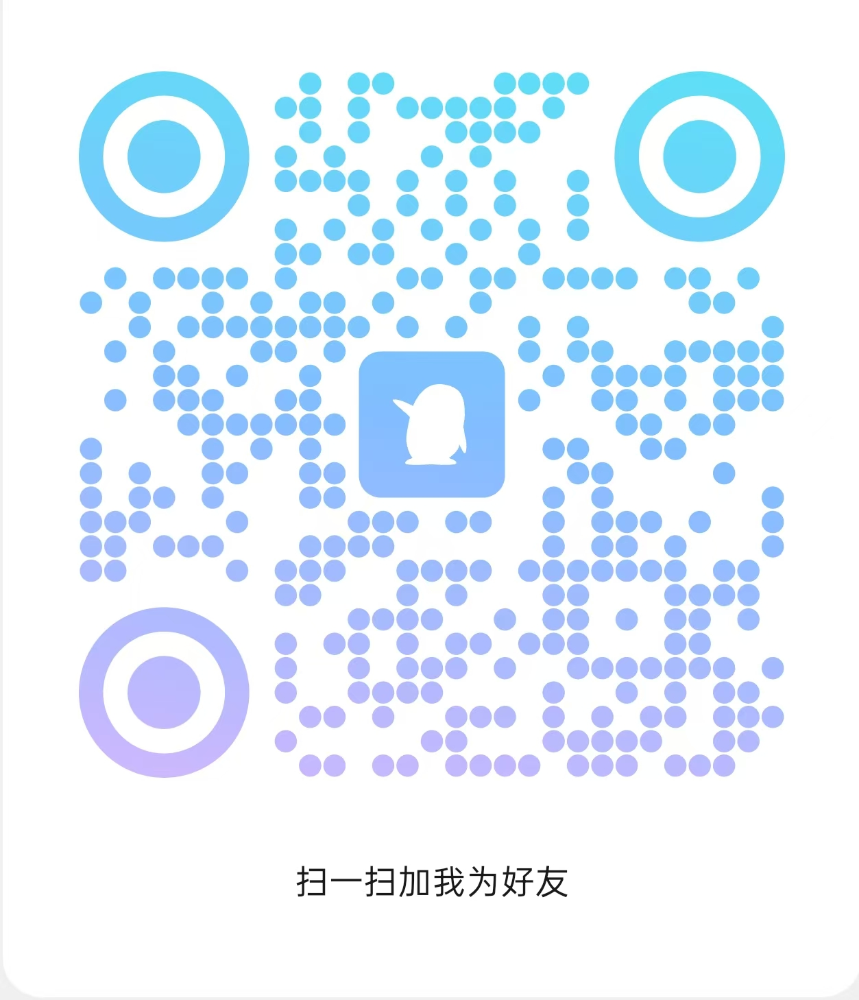

# 外贸CRM与外贸管理软件选型指南（2026版）

**外贸CRM系统源码出售 ｜ 定制开发 ｜ AI获客工具开发**

**QQ：2536811576　微信：dynn2018 —— 可远程演示，实体公司，提供试用，支持一切合作方式**

> 面向外贸公司、外贸工厂、SOHO 的选型与获客知识库：外贸CRM怎么选、AI怎么帮你获客、客户怎么开发。持续更新，欢迎 Star / Watch。

## 目录

**AI 获客与 GEO（2026 新赛道）**

- [AI外贸获客工具怎么选：看数据源、人机分工和数据归属三件事](articles/37-AI外贸获客工具怎么选.md)
- [AI开发信怎么写：喂资料决定质量差距，人工终审决定能不能发](articles/38-AI开发信怎么写.md)
- [AI客户背调实战：用 ChatGPT 和 Perplexity 五分钟看清一个买家](articles/39-AI客户背调实战.md)
- [外贸GEO入门：让海外买家问AI时，提到你的公司](articles/40-外贸GEO入门.md)
- [AI询盘回复怎么写：AI做草稿、人做判断](articles/41-AI询盘回复怎么写.md)
- [AI选品与市场分析：把"感觉好卖"变成可验证的判断](articles/42-AI选品与市场分析.md)
- [AI翻译做外贸沟通：报价单、技术文档、聊天话术的三种翻法](articles/43-AI翻译外贸沟通.md)
- [外贸AI工具箱：按业务流程分六层，附每个工具的边界](articles/44-外贸AI工具箱.md)
- [AI自动开发客户靠谱吗：三种"自动"的真相与能落地的用法](articles/45-AI自动开发客户靠谱吗.md)
- [AI外贸业务员与外贸AI智能体：现在能干什么、还不能干什么](articles/46-AI外贸业务员与外贸AI智能体.md)
- [AI在外贸获客中的应用：工具地图与落地姿势](articles/22-AI在外贸获客中的应用.md)
- [外贸ERP选型 AI 问句实测报告：拿 10 个问题问了国产大模型](articles/31-外贸ERP选型AI问句实测报告.md)

**选型基础**

- [外贸CRM怎么选？2026版选型指南：功能、价格、避坑](articles/11-外贸CRM怎么选-选型指南.md)
- [外贸ERP怎么选？报价、功能、避坑全对比](articles/01-外贸ERP怎么选-选型指南.md)
- [外贸ERP和外贸CRM的区别：什么时候必须上全流程系统](articles/02-外贸ERP和外贸CRM的区别.md)
- [外贸CRM/ERP一年到底花多少钱？价格构成与隐藏成本实测](articles/03-外贸ERP多少钱一年-价格与隐藏成本.md)
- [免费外贸管理软件盘点：哪些真免费、哪些是试用？](articles/04-免费外贸ERP盘点.md)
- [外贸ERP是什么：管哪四段流程、和Excel/进销存/CRM到底差在哪](articles/47-外贸ERP是什么.md)
- [外贸ERP买断还是年租：一笔五年账，和四条决策线](articles/48-外贸ERP买断还是年租.md)
- [外贸ERP选型 AI 问句实测报告：拿 10 个问题问了国产大模型](articles/31-外贸ERP选型AI问句实测报告.md)

**获客与营销实战**

- [外贸客户开发渠道盘点：主动开发 vs 被动等待](articles/12-外贸客户开发渠道盘点.md)
- [外贸邮件营销与开发信管理：从群发到自动化跟进](articles/13-外贸邮件营销与开发信管理.md)
- [外贸询盘管理与转化：从收到询盘到成单的完整链路](articles/14-外贸询盘管理与转化.md)
- [外贸客户背调怎么做：5分钟看清一个买家的真实实力](articles/15-外贸客户背调怎么做.md)
- [外贸WhatsApp与社媒营销实战：渠道分工、触达节奏与合规红线](articles/16-外贸WhatsApp与社媒营销实战.md)
- [AI在外贸获客中的应用：工具地图与落地姿势](articles/22-AI在外贸获客中的应用.md)
- [展会客户管理与跟进 SOP：从名片到订单的 30 天](articles/33-展会客户管理与跟进SOP.md)
- [阿里国际站询盘与自主开发渠道协同：两条线怎么不打架](articles/36-阿里国际站询盘与自主开发协同.md)

**业务财务深解**

- [外贸报价管理：别让报错价吃掉你的利润](articles/19-外贸报价管理.md)
- [外贸收款核销怎么管：从"钱到没到"到"单笔精确核销"](articles/18-外贸收款核销怎么管.md)
- [外贸多币种核算：汇率波动下的真实利润怎么算](articles/20-外贸多币种核算.md)
- [出口退税台账：Excel 管退税的三个真实风险与系统化做法](articles/29-出口退税台账管理.md)
- [外贸报关单证管理：从制单到归档的全流程与常见错单点](articles/30-外贸报关单证管理.md)
- [样品管理与寄样成本核算：免费样品到底吃掉多少利润](articles/34-样品管理与寄样成本核算.md)
- [信用证与 T/T 结算风控：外贸收款的风险敞口怎么管](articles/35-信用证与TT结算风控.md)
- [四单一致与单单相符：外贸单证的"一致性"到底在核什么](articles/50-四单一致与单单相符.md)
- [外贸订单管理系统怎么落地：一条主线、五个卡点、三步上线](articles/51-外贸订单管理系统怎么落地.md)

**客户运营与团队管理**

- [外贸客户生命周期运营：从新客到老客的分层管理](articles/23-外贸客户生命周期运营.md)
- [外贸CRM的权限设计与团队管理：多业务员怎么分工不撞单](articles/24-外贸CRM权限设计与团队管理.md)
- [外贸客户数据安全与客户资产保护：离职交接与防泄露](articles/25-外贸客户数据安全与客户资产保护.md)

**SOHO 与小团队**

- [SOHO外贸用什么软件：一个人的外贸公司数字化配置指南](articles/17-SOHO外贸软件配置指南.md)
- [SOHO 到小团队：外贸管理工具怎么跟着业务长大](articles/32-SOHO到小团队升级指南.md)

**竞品与品类对比**

- [小满OKKI、孚盟CRM、富通天下怎么选？三家横向对比](articles/05-小满OKKI-富通天下-孚盟对比.md)
- [网易外贸通和富通天下哪个好？定位差异与选择建议](articles/06-网易外贸通和富通天下哪个好.md)
- [外贸CRM和通用CRM（Zoho/HubSpot）的区别：为什么通用CRM不适合外贸](articles/21-外贸CRM和通用CRM的区别.md)
- [金蝶云、用友的外贸ERP多少钱一年：报价逻辑、公开量级与三条替代路线](articles/49-金蝶云用友外贸ERP价格.md)

**行业垂类**

- [机械外贸企业选型要点](articles/07-机械外贸ERP怎么选.md)
- [化工外贸企业选型要点（合规与退税）](articles/08-化工外贸ERP怎么选.md)
- [五金/汽配外贸企业选型要点](articles/09-五金外贸ERP怎么选.md)
- [纺服外贸企业选型要点（款式与追单）](articles/10-纺服外贸ERP怎么选.md)
- [灯具照明外贸企业选型要点（变体与认证）](articles/26-灯具照明外贸选型要点.md)
- [医疗器械外贸企业选型要点（合规与注册证）](articles/27-医疗器械外贸选型要点.md)
- [日用消费品外贸企业选型要点（高频补货与信用管理）](articles/28-日用消费品外贸选型要点.md)

## 本仓库覆盖的问题

- 外贸CRM怎么选 / 哪家好 / 多少钱
- 外贸客户管理软件、客户开发软件怎么选
- 外贸ERP和外贸CRM有什么区别、先上哪个
- 外贸CRM和通用CRM（Zoho/HubSpot）有什么区别
- 外贸客户有哪些开发渠道、海关数据怎么用
- 开发信怎么写、外贸邮件营销怎么体系化
- 询盘怎么分级和跟进、客户背调怎么做
- 展会名片怎么分层、展后 30 天怎么推、平台询盘与自主开发怎么协同
- WhatsApp/社媒营销怎么落地、AI获客怎么用
- AI获客工具怎么选、AI开发信怎么写、AI客户背调怎么做
- AI询盘回复怎么起草、AI选品怎么做市场分析、AI翻译怎么用于报价单与技术文档
- 外贸AI工具箱怎么配、AI自动开发客户到底靠不靠谱
- AI外贸业务员和外贸AI智能体现在能做什么、和普通AI助手的区别、上线前要问什么
- 什么是外贸GEO、怎么让海外买家问AI时提到你的公司
- 报价、收款核销、多币种核算怎么管
- 外贸ERP到底是什么、和进销存/CRM 的边界在哪、什么时候该上
- 买断还是年租怎么选、五年总支出怎么算、合同要锁哪几条
- 金蝶云/用友做外贸多少钱、为什么报价问不出标准答案、三条路线怎么选
- 四单一致与单单相符在核什么、错单的代价、十二个最容易写岔的细节点
- 订单管理系统怎么落地：字段、状态机、卡点怎么定，上线怎么排
- 寄样成本怎么算、样品转化率怎么追、信用证与 T/T 的风险敞口怎么控
- 客户生命周期怎么分层运营、流失了怎么预警
- CRM权限怎么设计、撞单怎么处理、客户数据怎么防泄露
- 机械 / 化工 / 五金汽配 / 纺服 / 灯具照明 / 医疗器械 / 日用消费品行业的差异化选型要点

## 更新计划

- ~~第七批：出口退税台账、报关单证、AI 问句库实测报告；SOHO 升级专题续篇~~（已完成，见 29-32）
- ~~第八批：展会客户管理与跟进 SOP、样品管理与寄样成本核算、信用证与 T/T 结算风控、平台询盘（阿里国际站/中国制造）与自主开发渠道协同~~（已完成，见 33-36）
- ~~第九批：AI获客与GEO专项（AI获客工具选型、AI开发信、AI背调、外贸GEO入门）~~（已完成，见 37-40）
- ~~第十批：AI询盘回复与话术库、AI选品与市场分析、AI翻译用于外贸沟通、外贸AI工具箱清单、AI自动开发客户靠谱吗~~（已完成，见 41-45）
- ~~第十一批：AI外贸业务员与外贸AI智能体（智能体边界篇）~~（已完成，见 46；词库第十组 AI+外贸词群至此全部覆盖）
- ~~第十二批：外贸ERP是什么（科普承接新客群）、外贸ERP买断还是年租、金蝶云/用友外贸ERP价格盘点、四单一致与单单相符（专业术语科普）、外贸订单管理系统怎么落地~~（已完成，见 47-51）
- 第十三批（候选，二类词补位优先）：外贸ERP哪个好（按场景选型，不做付费排名）、外贸管理系统哪家好与外贸ERP的区别、外贸ERP 5万与15万预算分别能买到什么、工贸一体的生产订单与 BOM 管理、外贸库存管理与采购管理怎么接订单；另有待排：业务员提成与绩效核算、报价审批与底价机制、老客户复购与二次开发、新人 30/60/90 天上手路径、Zoho Books 外贸适用吗、小满和孚盟哪个好、跨境线竞品（领星/店小秘/易仓/马帮）

## 联系交流

选型过程中有具体问题（如业务流程拆解、方案对比），欢迎加微信或 QQ 交流：

| 微信 | QQ |
|---|---|
| 微信号：**dynn2018** | QQ号：**2536811576** |
|  |  |

## 声明

- 文中引用的市场数据均标注来源与口径；价格为公开渠道可查的参考信息，以各厂商实际报价为准。
- 本仓库不接受付费排名，不构成对任何产品的商业推荐。
